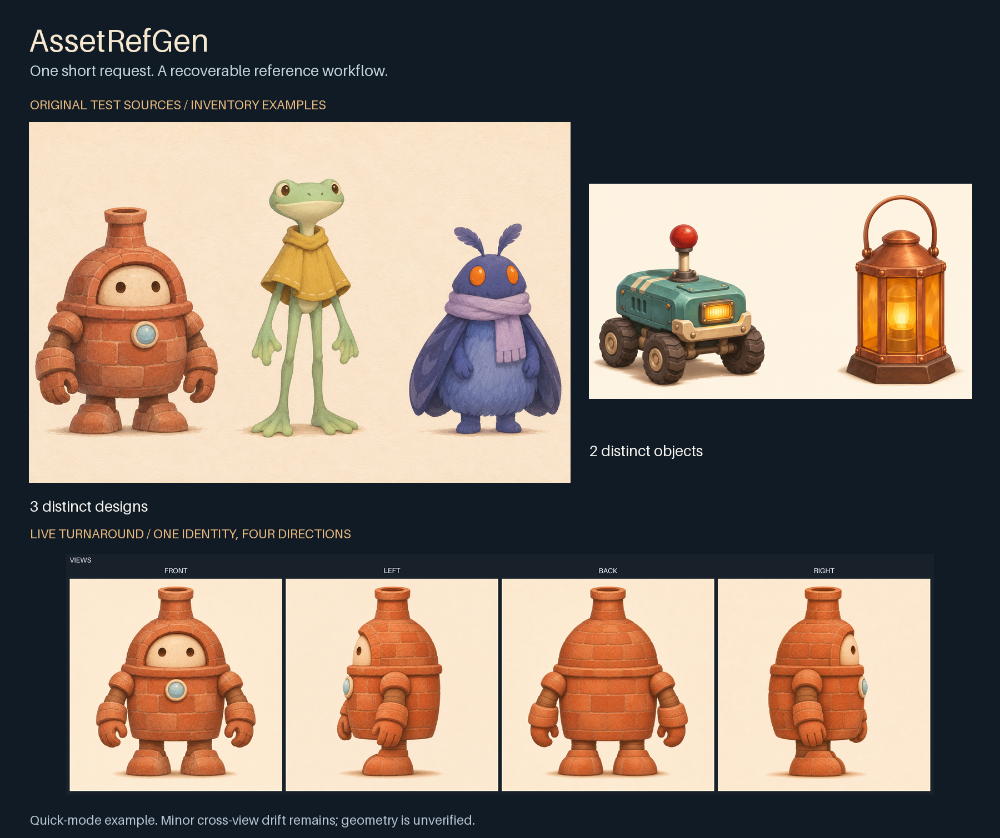
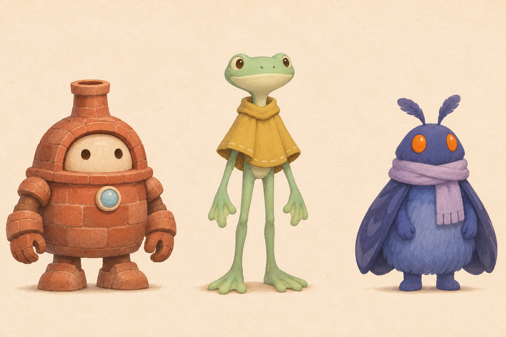
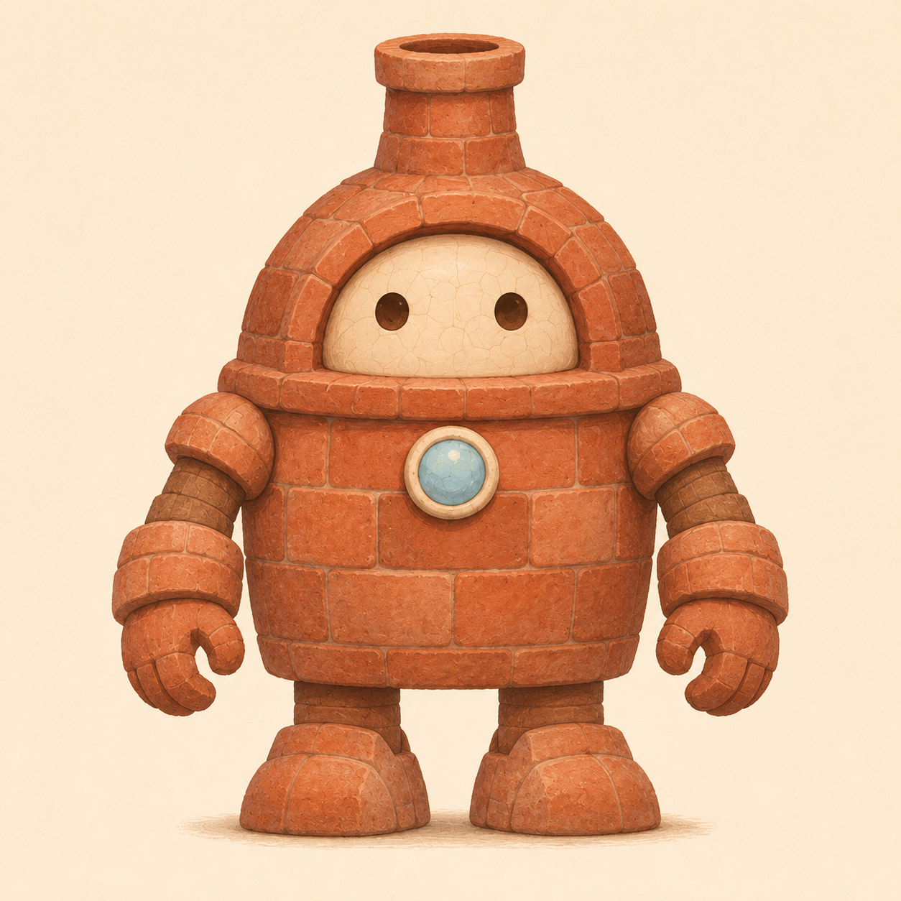
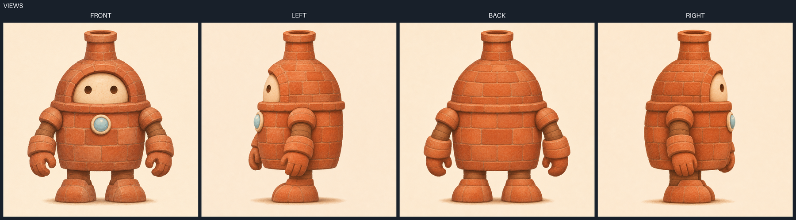

# AssetRefGen

**Turn concept art into organized, multi-view 3D modeling references with AI.**

AssetRefGen is a Codex skill for character, creature, vehicle, and prop references. Start with a single design, a lineup, a written brief, or a folder of concepts. Codex identifies the subjects, establishes an isolated master image for each, and uses that master to guide the directional views.

Built for game developers, 3D artists, modders and independent creators, its organized PNG references fit Tripo, Meshy, Blender and other modeling workflows.

[](examples/gallery.png)

The gallery shows original example art and the kiln traveler, the one subject taken through a complete live turnaround. The other designs were inventoried for roster and folder testing. [Explore the examples](examples/README.md)

## Get started

Paste this version-pinned request into Codex to install the skill.

```text
$skill-installer Install assetrefgen from https://github.com/AERIF-Dev/AssetRefGen/tree/v0.2.0/skills/assetrefgen
```

Open a new Codex session, attach your art or point to its location, and try one of these requests.

```text
$assetrefgen Make four views of this character.
$assetrefgen Process this entire roster.
$assetrefgen Generate references for every creature in this image.
$assetrefgen Process all assets in this folder in Quick Mode.
$assetrefgen Resume my unfinished batch.
```

The file helpers require Python 3.10+ and Pillow 10.1+. The v0.2.0 helpers passed validation on Windows and Linux. macOS compatibility is unverified. For installation paths and dependencies, see the [install guide](docs/INSTALL.md). The [quickstart](docs/QUICKSTART.md) and [sample prompts](docs/SAMPLE_PROMPTS.md) cover common requests.

## What you get

| Input | Workflow |
| --- | --- |
| One subject | **Single Asset** uses a brief, one image, or several panels of the same design. |
| Several subjects on one sheet | **Roster Mode** inventories the distinct designs, groups repeated appearances, and marks source positions on a numbered locator. |
| A folder of concepts | **Folder batch** handles a mix of individuals, rosters, and repeated designs across files. |

- **Choose your review depth.** Quick is the default, with one targeted major-correction attempt per asset. Detailed adds deeper visual checks and allows up to three.
- **Choose your generation order.** Make all masters first for early roster coverage, or finish one asset at a time to review complete sets as they land.
- **Trace each result back to the source.** Asset folders capture source evidence, identity notes, the master, PNG views, contact sheets, QA, and generation provenance.
- **Resume or share a review ZIP.** Per-image checkpoints let a later session validate and reuse existing work. A requested ZIP can include usable partial sets with an omission report.

## From lineup to reference set

| Original character roster | Isolated kiln traveler master | Four-view contact preview |
| :---: | :---: | :---: |
| [](examples/sources/characters.png) | [](examples/kiln-traveler/master_front.png) | [](examples/kiln-traveler/contact_preview.png) |
| The lineup contains three distinct designs. | The master uses the leftmost design as its reference. | The front reuses the master. The left, back, and right are derived views. |

## Image generation and limits

AssetRefGen calls compatible image-generation tools available in the active Codex session and uses whatever access and credits that session provides. When generation is unavailable, Codex can prepare the inventory, planned views, and prompts. If the session ends, use its checkpoint to resume in a later one.

The skill supplies no image-generation credits and does not automatically create 3D models or rigs. Roster interpretation is performed by Codex; the Python helpers manage files and progress. Execution and concurrency depend on the active environment.

The outputs are PNG references for modeling. The views approximate orthographic angles and can differ in pose, seams, and geometry. Use the native images and QA notes to check details before modeling. Mesh creation and 3D service jobs are outside the scope of the skill. [Kiln traveler visual QA](examples/kiln-traveler/qa.md)

## Release and project

- [v0.2.0 release](https://github.com/AERIF-Dev/AssetRefGen/releases/tag/v0.2.0)
- [Standalone skill ZIP](https://github.com/AERIF-Dev/AssetRefGen/releases/download/v0.2.0/assetrefgen-0.2.0-skill.zip) · [Full project ZIP](https://github.com/AERIF-Dev/AssetRefGen/releases/download/v0.2.0/AssetRefGen-0.2.0.zip) · [SHA-256 checksums](https://github.com/AERIF-Dev/AssetRefGen/releases/download/v0.2.0/SHA256SUMS.txt)
- [Changelog](CHANGELOG.md) · [Contributing](CONTRIBUTING.md) · [MIT License](LICENSE)
- [Proposed v0.3.0 roadmap](docs/ROADMAP.md) — poses, optional views, equipment extraction and supporting visual guides.

AERIF-Dev maintains AssetRefGen and releases it under the MIT License. This is not an official OpenAI product. Copyright © 2026 AERIF-Dev.
