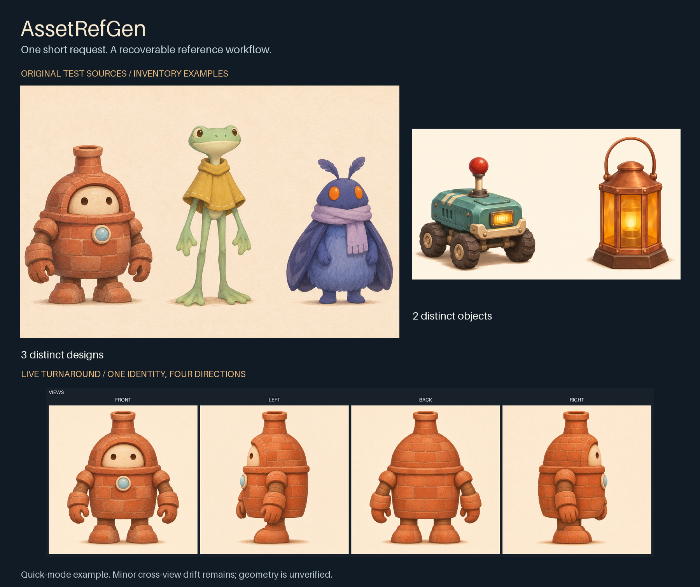

# Original public examples

These sources were created with built-in image generation specifically for this project. They contain no private game artwork or project lore. The six generation calls produced two source rosters, one isolated character master, and three derived views. The front direction reuses the suitable master bytes. No large production batch was regenerated for testing.

| Example | Inventory | Expected interpretation |
| --- | --- | --- |
| Single character | [single.inventory.json](single.inventory.json) | One kiln traveler from the left portion of the lineup |
| Character/creature roster | [characters.inventory.json](characters.inventory.json) | Three different designs, including two creatures; masters-first order |
| Mixed objects | [objects.inventory.json](objects.inventory.json) | A vehicle and a lantern prop; per-asset order |
| Folder batch | [folder.inventory.json](folder.inventory.json) | Five designs across two original source images |
| Multiple angles | [multiview.inventory.json](multiview.inventory.json) | One design, four regions; not four assets |
| Repeated design across files | [repeated-folder.inventory.json](repeated-folder.inventory.json) | Three designs, seven appearances; kiln repeated in the lineup and turnaround |

The inventories are examples of Codex's visual decisions, not output from a standalone object detector. An independent visual review confirmed the three/two/one interpretations without consulting these inventory files.

The [kiln traveler](kiln-traveler/contact_preview.png) is the live single-asset demonstration. Its [QA](kiln-traveler/qa.md) records minor seam/hand/pose drift and provisional rear construction. Other roster subjects were inventoried but not fully generated; functional tests exercise their scheduling and recovery using explicitly labeled test/imported files.

Run `python scripts/prepare_examples.py` from the package root to verify/recreate the inventory JSON. It makes no image-service calls. `python scripts/build_gallery.py` rebuilds this presentation from existing images. The original native PNGs remain the reference inputs.

Exact local requests and raw generation receipts remain in the working project. The public ZIP includes portable prompt copies and a path-rebased example manifest; these are labeled as exports, not byte-exact execution receipts. See [public export notes](PUBLIC_EXPORT.md).
